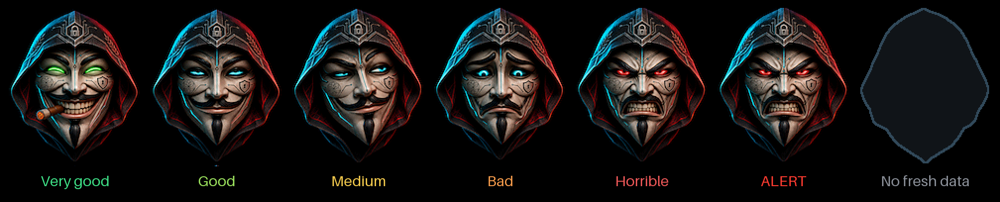

<p align="center">
  
</p>

<h1 align="center">M5 Guardian</h1>

<p align="center">
  <a href="LICENSE"></a>
  <a href="firmware/art/LICENSE"></a>
  
  
  
  
</p>

<p align="center">
  
  <br>
  <sub>Persona art © 2026 Felipe Cavalcanti, all rights reserved (<a href="firmware/art/LICENSE">firmware/art/LICENSE</a>); published with the repository, not under its MIT license.</sub>
</p>

A pocket radio guard for your own Wi-Fi. It runs on an M5 StickS3, listens to the 2.4 GHz air around
one network that you pick, and shows on its screen how that network advertises itself and whether
something on the air looks wrong: a face with five moods for the network's advertised security
settings, a red **ALERT** for an incident on your network, an amber notice for something nearby, and
a plain **No fresh data** when it has not heard the network recently.

It is a detector. It listens and counts; the firmware has no raw-frame transmit call. It joins a
network only as an ordinary client for its own signed update check, and raises a short-lived setup
access point when you ask it to. It does not recover passwords, does not judge how strong a password
is, does not name a tool or a person, and does not promise that a network is safe.

The detection library is portable C++17 with no board or SDK dependency: it is developed and tested on
a host first, then run against live radio on the host, and only then built into firmware. The StickS3
is the first board, not a requirement of the library.

## What it shows

| On the glass | Meaning |
|---|---|
| **Very good**, **Good**, **Medium**, **Bad**, **Horrible** | The rating of the settings the picked network advertises right now (protocol, cipher, management-frame protection). It is a rating of advertised settings, shown only while the evidence is fresh. |
| Red **ALERT** and one sentence | An incident on the picked network, for example "Disconnect burst on" and the network's name, with the count and the time window. The cause is stated as unknown. |
| Amber edge and one sentence | Something nearby that is not aimed at the picked network, for example a probe flood. The rating does not change. |
| Amber "Router changed security" | Your own router changed its advertised security settings (for example after an update or a restart): what changed, old -> new, and "a downgrade" when it got weaker. It stays until you accept it on the Details page (hold the side key there). A router that only moves channel is followed silently and shown as one grey line on the details page. How these are coloured is the **Router changes** setting. |
| **No fresh data** and an age | The network was not heard for 29 seconds or more. No rated face is shown without fresh evidence, and silence is never reported as "all clear". |
| **DEMO n/5** | A labelled walk through the five faces, kept for development: no key opens it (since G24), and holding the front key leaves it. It is never shown as a reading. |
| **SETTINGS n/3** | The device settings, one big option per page: how the guard listens on battery, the screen brightness and how your router's own changes are shown. The first two show their battery hours **measured** on the stick from full to the 20 % floor, the highest and lowest measured marked, or "not measured yet". |

Two keys, each used alone (one hand is enough):

| Where | Front (blue) key | Hold front | Side key | Hold side |
|---|---|---|---|---|
| Face | details, first page (the router's change first while one waits) | Settings screen | (nothing) | network list |
| Details | next page; after the last, the face | Settings screen | the face | network list; on the "Your router changed" page: accept the new settings |
| Settings screen | the face, nothing more saved | the face, nothing more saved | next choice (wraps) | save this page, then the next page; after the last, the face |
| Network list | next network | "this AP is mine too" on a same-name row | choose | back |

The details pages give the reason for the rating, the evidence counts and a page named "What it
cannot see". Pressing the front key three times fast asks for an update (or opens the phone setup
when no Wi-Fi is stored); it counts only on the face, so stepping through details or settings never
opens it.

| Setting | Choices | Measured battery hours (full to the 20 % floor) | What it costs |
|---|---|---|---|
| Guard on battery | **Always** (default: today's behaviour) | 2 h 05 min (lowest, measured) | nothing: never blind |
| | **Every 30 s**: listen 10 s, radio off 20 s | not measured yet | an alert can be up to 20 s late; a short burst inside an off period is missed |
| | **Every minute**: listen 10 s, radio off 50 s | 7 h 14 min (highest, measured) | an alert can be up to 50 s late; a short burst inside an off period is missed |
| Brightness | 10, 30, **60** (default), 80, 100 % | not measured yet | costs only while the screen is lit |
| Router changes | **Details only**: listed on the Details page, no colour | (costs nothing) | a security change of your router is never coloured |
| | **Amber** (default): a security change is amber until you accept it; a channel move is one grey line | | |
| | **Strict**: a security change is the red ALERT until you accept it; a channel move is amber until you acknowledge it | | |

The two cycled choices act only on battery while the screen is dark; a key, motion, USB power or a
counted burst lights the screen and the radio listens at once. The hours come from the G24 battery
spike ([firmware/evidence/sticks3-G24-spike-20261121.log](firmware/evidence/sticks3-G24-spike-20261121.log));
nothing on the Settings screen is an estimate. In every choice the parts the Guardian does not use
are off from boot: the green status LED, the 5 V boost, the speaker amplifier, the infrared LED's
gate and the audio codec (STATUS `parts=` reads them back from the registers).

## What it detects

Every rule is passive. Most work on the management frames of the channel the picked network uses;
two (handshake-harvest signs, the noise floor) need more than that and are marked below. The numbers
are counts in a time window, and each one can be changed over the tuning console.

| Family | Colour | Proven on the device |
|---|---|---|
| Disconnect burst (deauthentication or disassociation frames) on the picked network, on any address heard under its name, or a nearby burst that also names it | red | yes: owner's runs of 2026-11-17 and 2026-11-19 |
| Disconnect burst nearby | amber | yes: 2026-11-17 and 2026-11-19 |
| Probe flood | amber | yes: 2026-11-17, at 16 probes from 12 addresses in 10 s |
| Beacon flood | amber | fired on 2026-11-17; counts and time-to-alert not recorded |
| Another device using the picked network's name (on by default) | red | no: host tests only |
| Baseline change of the picked network's advertised settings | amber by default (G25: red only with Router changes = Strict); a channel move is followed silently | before G25, red on the host with live radio (L02) and through the ESP32 adapter (G13); the G25 colours are host-tested only |
| Responder to many asked names, lure names, marked beacons, channel-switch and Quiet abuse, authentication and SAE floods, association floods | red or amber by scope | no: host tests only |
| Handshake-harvest signs (needs the data path: only unprotected key-handshake frames pass a prefilter, every other data frame is dropped before the queue) | red | no: the data path is off by default until its load on the device is measured |
| Noise-floor rise on the channel (the radio's own noise estimate, no frames needed) | amber | no: host tests only |
| Bluetooth pairing-popup spam | amber | no: the library rule is host-tested; the StickS3 runs no Bluetooth scan |

The full matrix, with the evidence file of every proven row and the source of every threshold, is in
[docs/attack-coverage.md](docs/attack-coverage.md).

## What it cannot see

- 5 GHz and 6 GHz. The ESP32-S3 radio is 2.4 GHz only.
- Other channels while it is locked to the picked network's channel.
- A listener that never transmits.
- Anything inside the network after a client has joined (no data inspection).
- Bluetooth, on this board.
- A transmitter that copies the picked access point's own address, name, settings and channel: it is
  counted as the network itself.
- The air during its own update check: on a stick with an update server stored, by default every 120 s
  the stick stops listening for the seconds the check takes. A due check waits while a red ALERT is
  active. A stick without an update server (installed from the website) never checks by itself.
- Who is behind an event. It names the behaviour and the counts, never a tool or a person.

A detector that has never fired on the device is listed as unproven, not as protection.

## Hardware

- **M5 StickS3**: ESP32-S3-PICO-1 with 8 MB flash and 8 MB PSRAM, a 135x240 ST7789 screen, a BMI270
  motion sensor, the M5PM1 power chip, two keys and the built-in battery. It stands on its USB
  connector. No SD card and no companion computer are needed to run it.
- Firmware: native ESP-IDF v5.4 (commit `67c1de1eebe095d554d281952fde63c16ee2dca0`), no Arduino
  runtime and no M5 library in the image.
- A second board is not required. The optional lab rig (a separate receiver and a stimulus board) is
  described under [lab/](lab/live/README.md) and is used only for owner-launched validation runs.

## Build and install

You need a Mac or Linux host with CMake and a C++17 compiler for the host checks, ESP-IDF v5.4 at the
commit above for the firmware, and a folder for build output (the artifact store).

```sh
# 1. your local settings: the artifact store and, for the lab tools only, your own bench values
mkdir -p ~/.config/m5-guardian
cp lab/local.conf.example ~/.config/m5-guardian/local.conf      # then set GUARDIAN_STORE in it
#    and create an empty file named .guardian-store-root in that folder (the tools refuse a store without it)

# 2. the portable library on the host: build + every check, plain and with ASan/UBSan
firmware/tools/host-check.sh

# 3. your own update-signing key (once; it never enters the repository), then the signed image
firmware/boards/sticks3/tools/build.sh keygen
firmware/boards/sticks3/tools/build.sh build                    # archive: $GUARDIAN_STORE/builds/<stamp>-sticks3

# 4. first install over USB: read a full backup first, then let the script print the exact command
GUARDIAN_PORT=/dev/cu.usbmodemNNN GUARDIAN_ARTIFACT_DIR=$GUARDIAN_STORE/builds/<stamp>-sticks3 \
    firmware/boards/sticks3/tools/build.sh flash-command

# 5. every later update over Wi-Fi: the stick fetches a signed, newer image by itself
python3 tools/ota_serve.py $GUARDIAN_STORE/builds/<stamp>-sticks3
```

On the stick: pick your network in the list (hold the side key), then hold the side key for 3 s on it to give the
stick the Wi-Fi password from your phone. The password is needed only for the update check; the
guarding itself never joins a network. Backup, restore, the asset pipeline and every console command
are in [firmware/README.md](firmware/README.md).

## Status

Measured state on 2026-11-21, taken from the ledger ([guardian-tasks.json](guardian-tasks.json)): 44
of 46 rows are accepted. The open rows are G24 (the Settings screen, release 1) and G16U (Bluetooth
guard, deferred to a second release). "Accepted" means the row's own verification was done by the supervising
reviewer; what was measured is in the last column, with the row that records it.

| Area | Rows | State | Measured |
|---|---|---|---|
| Portable library: parser, ratings, freshness, detectors, advice, presenter | G01-G09 | accepted | 54 host checks pass, plain and under ASan/UBSan, on the sources of 2026-11-20 (how they were run is in docs/G23-delivery.md) |
| Live radio against the library on the host | L01, L02 | accepted | 10 of 10 live cases passed with the real library (docs/L02-live-validation.md) |
| StickS3 bring-up and the ESP32 adapter | G10-G13 | accepted | screen, keys, PSRAM and storage on the real unit; 11 bounded live scenarios through the adapter |
| Network list, keys, persistence, red ALERT | G14 | accepted | owner's hands-on and live scenarios, 2026-11-15 and 2026-11-16 |
| The five faces and their wording | G15-G20, G16Q | accepted | the v4 portraits are in the image byte for byte (16 of 16); owner on the glass 2026-11-19: "Functionality is perfect" |
| Signed updates and rollback | G16B, G22A | accepted | good update installed; bad signature refused; a failed self-test rolled back; an unsigned session offer and an older image refused (2026-11-19) |
| Screen, motion, frame rate | G16A, G16C, G16I, G16O | accepted | 24.9 frames a second; worst particle frame 33.7 ms (2026-11-19) |
| Battery: dim, dark guard, deep sleep, self wake on USB | G16D, G16N, G16P | accepted | an incident lit the dark screen (evidence after 53 ms, frame after 101 ms); the USB check of a timer wake took 974 and 986 ms of a 1000 ms budget; in dark guard the cell fell 60 mV per 10 minutes (owner's soak, 2026-11-20). The means to split that drain per setting are built and host-tested, not yet measured (docs/G23-delivery.md section 11) |
| Detection platform and passive detectors | G16E-G16G, G16J, G16R-G16T | accepted | red on the owner's network and amber nearby proven live; 0 false incidents in 9.8 h of a benign soak (outside the owner's own 17-minute test window); the other families are host-tested only |
| Phone setup | G16M | accepted | the owner stored the home Wi-Fi from the phone on 2026-11-19; the credential is still stored plain (the encrypted vault needs one USB sitting and an eFuse key) |
| 3D head | G21 | accepted, off by default | one frame inflates in 14.8 ms on the stick; the approved look is the 2D portrait |
| Bluetooth popup-spam rule | G16H | accepted, host only | no Bluetooth scan runs on the stick |
| Integrated review | G22 | accepted | independent verdict "REVISE INTEGRATED"; findings and dispositions in docs/review-status.md |
| Delivery | G23 | accepted | the owner's run of 2026-11-21 (firmware/evidence/sticks3-G23-20261121.log); the device recordings are listed in docs/G23-delivery.md |
| Settings: guard on battery, brightness, unused parts off | G24 | **open**: implemented and host-tested, awaiting review and the device acceptance | the hours shown are the G24 spike's full drains (always listening 2 h 05 min; listen 10 s / off 50 s with every lever 7 h 14 min, 380 cycles with 0 radio, rail or power-management failures); the six Settings pages render pixel for pixel as the owner-approved look; nothing of G24 is measured on the stick yet (firmware/README.md, G24) |
| Router changes are not an alarm; Settings keys with the side key | G25 | **open**: implemented and host-tested, awaiting review | a channel move is followed and counted (STATUS `channel_moves=`), a security change is amber until accepted, ROUTER CHANGES is Settings page 3, the Settings keys are side = next, hold side = save, front = back; nothing of G25 has run on the stick (firmware/README.md, G25) |
| Bluetooth guard | G16U | open, release 2 | not built |

Router modes: the ratings were seen on the device for the owner's own router and, for all five faces,
through the labelled DEMO walk. Which advertised modes were observed live and which only as fixtures is
recorded in [docs/G23-delivery.md](docs/G23-delivery.md).

## Lab rules

- Everything here is for your own network and your own devices.
- Test traffic is started by the owner, against the owner's network, on a named channel, for a
  bounded time. No tool, build or agent session in this repository starts it as a side effect.
- A replay or a simulated incident never counts as live evidence. Fixture results are labelled as
  fixtures.
- A row is accepted only on its own evidence; a hardware or visual check that was not done stays open.
- Lab values (network names, radio addresses, host names, paths) stay outside the tree: arguments,
  the environment or `~/.config/m5-guardian/local.conf`. Evidence logs carry placeholders.
- Detection is described by counts, scope and uncertainty. No claim of detecting every attack.

## Where things are

```text
firmware/components/     the portable library: evidence core, parser, detectors, advice, presenter, canvas
firmware/adapters/       SDK-free mechanics: measurement, companion screens, motion, updates, setup, power
firmware/boards/sticks3/ the StickS3 ESP-IDF project and its build script
firmware/tests/          host checks and fixtures; firmware/tools/host-check.sh runs them all
firmware/evidence/       device logs and photos (real device output only)
lab/                     the owner-launched live validation rig
tools/                   update server, tuning session, art pipeline, public-tree check
docs/                    design, validation records, coverage, history
guardian-tasks.json      the ledger: every task, its steps and its acceptance
```

- [Firmware guide](firmware/README.md): build, assets, USB device, install, restore, console
- [Delivery record](docs/G23-delivery.md): requirement-to-evidence table, limits, what is still open
- [Attack coverage](docs/attack-coverage.md) and [review status](docs/review-status.md)
- [Architecture](docs/architecture.md), [contracts](docs/contracts.md), [roadmap](docs/roadmap.md)
- [Development history](docs/history.md): the dated state log of the project
- [Task runner](docs/ralph.md) and [research](docs/research/research.md)

## License

- **Code, scripts, tests and documentation:** MIT, see [LICENSE](LICENSE).
- **Guardian persona artwork** (portraits, masters, sheets, the 3D source, frame packs): all rights
  reserved, see [firmware/art/LICENSE](firmware/art/LICENSE). It is in the repository so the firmware
  can be built; it is not covered by the MIT license.
- **Third-party material:** see [THIRD_PARTY_NOTICES.md](THIRD_PARTY_NOTICES.md).

## Before you commit

The tree holds no personal or machine-specific value (radio addresses of real devices, home or
volume paths, host names, key files). `python3 tools/public_check.py` proves it and must report no
findings; enable it for every commit once per clone with `git config core.hooksPath tools/hooks`.
Lab values live outside the tree; evidence logs carry placeholders such as `OWNER-AP-1`.
