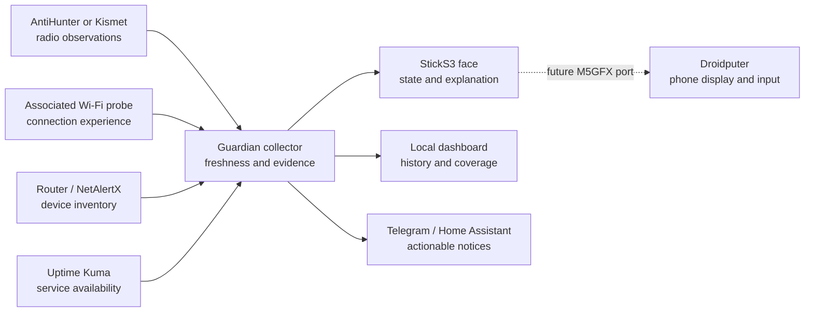

# Guardians: research, reuse plan, and prototype

> **Current implementation direction (2026-11-13):** the later user requirements supersede the early prototype/architecture proposals below. Build a standalone native-ESP-IDF StickS3 companion, no Arduino or SD card, with an original 3D persona and five security-setting moods. The [Wi-Fi source audit](wifi-audit.md) records AntiHunter branch findings and measurement limits; [guardian-tasks.json](../../guardian-tasks.json) is the implementation checklist. All tasks remain unfinished. `./archive/guardian-demo` is only the older browser study, with no live radio connection. Prove actual on-device Wi-Fi measurements before polishing art or claiming protection.

Research date: **13 November 2026**. This combines Felipe's proposed products, primary-source research, and inspection of the local hardware inventory and projects. Vendor features are documented claims, not independent performance measurements. Local historical test reports are distinguished from tests performed today.

## Decision

**Build Guardian as a small, understandable network observer with a physical face. Start with equipment already here.** The first useful product should answer four questions:

1. Is the connection working from this room?
2. Has something unusual happened to my network or nearby radio environment?
3. What evidence supports that conclusion?
4. Is Guardian actually observing, or has its sensor stopped reporting?

Use an available **StickS3 for the face**, the existing **AntiHunter/RF lab work for radio observations**, and **LAB-PI-HOST for aggregation and history**. Add an associated Wi-Fi probe for actual connection measurements. Reuse existing monitoring systems through adapters rather than rebuild their engines. A software-only mode should work before any board is flashed. A standalone ESP version is a later, smaller product with explicitly limited coverage.

The distinguishing feature is the clear physical indication plus an explanation: “Wi-Fi signal weakened in the office,” “Internet checks failed but the gateway responds,” or “A burst of disconnect frames was observed.” A green light must mean **no current issue observed within the reported coverage**, never “your network is safe.”

The existing [Guardians concept site](https://brow-hunter-gilt.vercel.app/) supplies the industrial-design direction: character sculptures, illuminated eyes, optional sound, and a companion view. Its live HTML was inspected; its app mockups and simulated alerts do not establish a working detector or mobile product.

## Three things that must remain separate

| Dimension | Useful measurements | What it cannot establish alone |
|---|---|---|
| Connection health | Association/reconnection events, RSSI, gateway reachability, DNS latency, HTTPS success, packet-loss samples, throughput on demand | Whether an attacker caused a failure |
| Security observations | Deauth/disassoc bursts, unexpected BSSID/security changes, unusual beacon/probe behavior, new LAN devices, selected BLE patterns | That every unfamiliar device is hostile; that silence means safety |
| Monitoring coverage | Sensor heartbeat, firmware/features, band/channel, listening interval, packet drops, last successful sample | Coverage of an unobserved band or channel |

RSSI measures received signal strength, not available bandwidth. A Wi-Fi channel containing many APs is not necessarily busier than one containing a single heavily used AP. Decoded Wi-Fi frames do not provide a calibrated spectrum view of non-Wi-Fi interference. A Pi connected by Ethernet measures a different path from a phone connected over Wi-Fi. ESPHome already exposes associated Wi-Fi RSSI; richer radio behavior requires the relevant firmware and capture capability. [ESPHome Wi-Fi signal](https://esphome.io/components/sensor/wifi_signal/), [Kismet passive capture](https://www.kismetwireless.net/docs/readme/intro/passive_capture/).

## What exists: products and projects worth learning from

| Project/product | Verified scope and important correction | Guardian decision |
|---|---|---|
| **Spacehuhn DeauthDetector** | Small ESP8266 program watching deauthentication/disassociation frames, with a threshold, channel hopping, and LED output. This is the upstream reference behind the Maltronics product. It is not an ESP32-S3 drop-in image. | Study the minimal detector and limitations; do not invent another undifferentiated frame counter. [Repository](https://github.com/SpacehuhnTech/DeauthDetector), [author's explanation](https://docs.spacehuhn.com/blog/deauth-detector/) |
| **Maltronics Deauth Detector** | Vendor advertises USB-A power, 2.4 GHz and two RGB LEDs; listed at £20 when checked. Narrow alarm, not connection diagnostics, a firewall, or comprehensive WIDS. | Closest simple physical reference. No purchase needed for our prototype. [Product](https://maltronics.com/products/deauth-detector) |
| **DSTIKE Deauth Detector V3** | Official product uses **ESP8266**, RGB LED and buzzer. Vendor documents missed frames/channel-hopping limitations. Listed at $15 in its collection. | Another direct physical reference. [Product](https://dstike.com/products/dstike-deauth-detector-v3pre-flashed) |
| **DSTIKE watches / Sidekick** | Model names matter: the current Deauther32 Watch MAX page describes **ESP32-C5**, not S3. A watch's auditing functions do not prove it implements every claimed detection mode. | Verify a specific model and firmware before buying. The supplied blanket “all S3, all detectors” description is inaccurate. [Watch MAX](https://dstike.com/products/deauther32-watch-max-the-ultimate-wireless-security-testing-watch), [collection](https://dstike.com/collections/ai-home-security-sidekick) |
| **ESP32 Marauder** | Official documentation includes signal/channel tools and Wi-Fi sniffers. BLE inventory and signature-specific detection must not be generalized to identifying every tracker or skimmer. Hardware and selected mode determine capability. | Existing lab reference; owning another preflashed board adds little immediately. [Wi-Fi sniffers](https://github.com/justcallmekoko/ESP32Marauder/wiki/wifi-sniffers) |
| **Hak5 WiFi Pineapple** | A family of auditing products, with different capabilities across Enterprise/Pager/other models. Enterprise documents automated passive/active assessments; that does not establish universal enterprise WIDS coverage for every Pineapple. | Learn reporting and workflows; not the first purchase for a household Guardian. [Enterprise](https://hak5.org/products/wifi-pineapple-enterprise), [Pager](https://hak5.org/products/pager) |
| **AntiHunter** | Upstream describes Wi-Fi/BLE observations, baselines and Sentinel detections. S3 is the established path; DIGI C5 is explicitly experimental/testing. Tool attribution, location and identity claims need independent validation. | Primary existing radio engine candidate, after refreshing the fork and checking actual runtime capabilities. [Upstream](https://github.com/lukeswitz/AntiHunter), [C5 notes](https://github.com/lukeswitz/AntiHunter/wiki/DIGI-C5) |
| **Kismet** | Established passive wireless capture/monitoring and alerts, with datasource-specific support. Linux Wi-Fi capture requires a compatible adapter and driver; BLE capabilities vary by datasource. | Best full radio-monitoring reference and eventual Pi integration. Avoid rewriting its packet processing. [Introduction](https://kismetwireless.net/docs/readme/intro/kismet/), [alerts](https://www.kismetwireless.net/docs/readme/alerts_and_wids/), [Linux Wi-Fi](https://kismetwireless.net/docs/readme/datasources/wifi-linux/) |
| **Wi-Fi Guardian by jeffreyesdavid** | Current README describes **macOS v1**, trusted SSID/BSSID/security checks, gateway-MAC-change indications and notifications. Dedicated ARP-spoof monitoring and deauth hints are roadmap items; Linux/Pi support is not established by this README. | Useful baseline and explanation ideas, not a ready cross-platform radio detector. [README](https://github.com/jeffreyesdavid/wifi-guardian/blob/main/README.md) |
| **Firewalla** | Router/bridge network security and new-device quarantine. Visibility depends on traffic traversing the device; same-LAN isolation requires additional network design. This is different from listening to Wi-Fi management frames. | Complementary if network enforcement is wanted later. Do not promise broad ARP-spoof detection from the supplied unsourced description. [Modes](https://help.firewalla.com/hc/en-us/articles/115004292514-How-Does-Firewalla-Intercept-Traffic-Which-Firewalla-Mode-Should-I-Use), [quarantine](https://help.firewalla.com/hc/en-us/articles/360058853313-Firewalla-New-Device-Quarantine) |
| **Fing Desktop / Agent** | Network discovery and continuous inventory through supported desktop/agent deployments, including Pi options. New device means unfamiliar inventory, not proven intruder. | Convenient packaged LAN inventory; compare with NetAlertX before paying. [Official overview](https://www.fing.com/scan/) |
| **NetAlertX** | Device discovery, history and plugins for router imports, DHCP leases, connectivity checks and notifications, including MQTT/Telegram. Coverage depends on configured sources and subnets. | Strong open-source choice for “what joined my network?” Reuse its output. [Documentation](https://docs.netalertx.com/) |
| **Uptime Kuma** | Self-hosted availability checks and notifications. | Reuse for gateway/service/Internet checks where appropriate; a wired check must be labeled wired. It does not replace a Wi-Fi sensor. [Repository](https://github.com/louislam/uptime-kuma) |
| **NetSpot / Acrylic** | Survey and troubleshooting tools: signal, channels, coverage and, where supported, packet-level diagnostics. Platform, edition and capture hardware affect available metrics. | Reference for portable room surveys and charts. Do not equate a heatmap with autonomous intrusion detection. [NetSpot](https://www.netspotapp.com/features.html), [Acrylic capture requirements](https://www.acrylicwifi.com/en/blog/wifi-monitor-mode/) |
| **NetBeez** | Sensors test the network from the client's perspective, including Wi-Fi deployments and historical measurements. | Particularly relevant to the *health* half of Guardian: put a probe where a person actually uses the network. [Wi-Fi monitoring](https://netbeez.github.io/netbeez-tutorial/wifi-monitoring.html), [Pi sensor](https://netbeez.net/blog/turn-your-raspberry-pi-into-a-wireless-monitoring-sensor/) |
| **Wyebot** | Its documented sensor combines multiple radios, client/passive operation, spectrum analysis and central analysis. Those hardware capabilities explain why an enterprise sensor sees more than one ESP. | Architecture reference for independent observer and client-probe roles; not a promise we can reproduce it with one StickS3. [Technical specifications](https://wyebot.com/platform/technical-specifications/) |
| **Home Assistant / ESPHome** | Existing display/sensor/automation ecosystem. MQTT discovery includes availability handling. | Reuse for household integration, room entities, quiet hours and output devices. [MQTT integration](https://www.home-assistant.io/integrations/mqtt/), [Wi-Fi signal](https://esphome.io/components/sensor/wifi_signal/) |
| **ESPresense** | BLE presence observations and room-level estimates; calibration and device identity handling matter. | Optional presence integration for enrolled devices, not a universal stalker detector or reliable meter-accurate location system. [Project documentation](https://github.com/ESPresense/ESPresense.com/blob/main/src/content/docs/quick-start.md) |
| **Suricata** | Network IDS/IPS and security monitoring engine. Requires appropriate network traffic visibility. | Later LAN-security source if the router/mirror arrangement supports it; do not run it just to claim a larger feature list. [Official introduction](https://docs.suricata.io/en/latest/what-is-suricata.html) |

Prices above are vendor-page snapshots, not delivered Brazilian prices. Brazil stock, taxes and shipping were not verified. The supplied Mercado Livre listing returned 403; the Tindie listing and YouTube link could not be retrieved reliably. Their specific claims are not treated as confirmed.

### PocketLab-StickS3: useful, with a different job

[PocketLab](https://github.com/Withphildev/PocketLab-StickS3) v0.17.0 documents a local WebUI, Wi-Fi/BLE surveys, baseline comparisons, signal history, room comparisons and battery/power management. The maintainer reports StickS3 hardware testing; that was not independently repeated here. Its MIT license makes reuse practical with attribution.

Source inspection found `WiFi.scanNetworks(false, true, false, 300)`: the passive-scan argument is false. It surveys without joining discovered networks, but **that is not receive-only scanning**. It also temporarily enables station mode beside its portal. The reviewed source does not establish a continuous deauth detector.

Borrow the learning flow, median-smoothed signal display, battery treatment and quiet UI. Do not fork the complete toolkit as Guardian's foundation: its large combined application, keyboard/file-vault features and survey portal solve different needs. The build profile is useful board evidence, not proof our firmware is tested. [README](https://github.com/Withphildev/PocketLab-StickS3/blob/main/README.md), [source](https://github.com/Withphildev/PocketLab-StickS3/blob/main/src/main.cpp), [build](https://github.com/Withphildev/PocketLab-StickS3/blob/main/platformio.ini).

## What we already own and should reuse

The inventory source is `home-automations/INVENTORY.md` (the owner's local home-automations project, outside this repository), cross-checked with project records. Arrival dates and historical USB tests are not a fresh physical audit.

| Equipment | Current evidence | Proposed role |
|---|---|---|
| **StickS3 #1** | Already assigned to the live push-to-talk terminal | Keep its existing job |
| **StickS3 #2** | Arrived; inventory says role TBD | First Guardian face/probe candidate |
| **StickS3 #3/#4** | Listed in transit; expected arrival date has passed, receipt not recorded | Additional rooms only after identifying available units |
| **Bare ESP32-S3 N16R8 / AntiHunter board** | RF lab identifies a board; inventory also reserves a bare N16R8 for esp-claw | Verify physical identity/assignment before assuming an extra spare; reuse installed observer if available |
| **ESP32-C5-DevKitC-1** | Owned, 8 MB flash, no PSRAM; previous board/toolchain issues documented | Later 5 GHz experiment, with its exact target; not interchangeable with XIAO C5 |
| **Cardputer ADV** | Existing display/keyboard/SD lab device | Portable survey console; keep Bruce workflow usable |
| **LILYGO T-Embed CC1101 Plus** | Existing Bruce capture device | Controlled lab observations and capture validation; separate CC1101/nRF24 are not 5 GHz Wi-Fi radios |
| **Pi 5 LAB-PI-HOST** | Existing always-on services, the store and Telegram; password testing also consumes CPU | Lightweight collector and reporting, with measured resource budget |
| **Atheros AR9271 adapter** | Latest inventory says **arrived dead, ditched** | Unavailable; older successful lab notes do not override this |
| **Android phone + Droidputer** | Existing USB display/input/shim project | Future portable Guardian console using a rebuilt M5GFX/M5Unified app |

StickS3 has the right enclosure, display and memory for prototyping: ESP32-S3, 8 MB flash, 8 MB PSRAM, 135×240 display, speaker and 250 mAh battery. It supports 2.4 GHz Wi-Fi; it does not acquire 5 GHz through a firmware update. The local proven build uses **octal PSRAM (`PSRAM=opi`)** and M5Unified board detection. Use USB power for an always-on prototype; actual battery life must be measured. [M5 documentation](https://docs.m5stack.com/en/core/StickS3), local hardware notes (the owner's local home-automations project, outside this repository).

The XIAO ESP32-C5 does exist and supports dual-band Wi-Fi, but its firmware/board support is a separate question. Bluetooth remains a 2.4 GHz technology. Do not flash a XIAO or 16 MB N16R8 image onto an 8 MB StickS3. [Seeed C5 documentation](https://wiki.seeedstudio.com/xiao_esp32c5_getting_started/).

### Existing software assets

- **AntiHunter fork:** HTTP detector health/incidents, serial diagnostics, generic N16R8 target, operator CLI and validation. Reuse its observation outputs. At inspection, local branch `agent/repository-guidelines`, commit `c6ef921`, inherited `AH_SENTINEL=0`: the always-on Sentinel start is compiled to a no-op and its status route is omitted. The user confirmed this checkout is outdated and requested a rebase. This is a version-specific finding, not an upstream product limitation. Installed board firmware remains unverified. `platformio.ini` (the owner's local AntiHunter checkout, outside this repository), `detect.cpp` (the owner's local AntiHunter checkout, outside this repository), `CLI` (the owner's local AntiHunter checkout, outside this repository).
- **RF/BLE lab:** `rf-brow-cli` already has detector, serial-guard and remote-agent adapters plus a Textual dashboard. Historical testing found that radio hopping can degrade the board's own HTTP access. Reuse the concepts and established interfaces; prefer USB transport for sustained observer telemetry when supported. `RF lab` (the owner's local RF/BLE lab project, outside this repository), `CLI` (the owner's local RF/BLE lab project, outside this repository).
- **Wi-Fi lab:** existing `defense snapshot`, the store evidence organization, Telegram transport and remote execution experience. Password recovery results belong in an assessment history, not the live safety indicator.
- **Droidputer:** located at `~/dev/droidputter`, public project [`fcavalcantirj/droidputer`](https://github.com/fcavalcantirj/droidputer). It mirrors rebuilt ESP apps over USB with keyboard/GPS input; the phone is the display, not an existing Guardian analysis engine. A Guardian M5GFX application could become a catalog recipe after a compatibility build. Existing firmwares do not automatically mirror without the shim. No new Android app is needed for that path. `Local README` (the owner's local droidputter checkout, outside this repository).
- **Home-automations StickS3 first-light code:** already verifies board detection, screen and PSRAM. Reuse M5Unified and the known build settings, not another guessed pin map. The live PTT firmware and its credentials are unrelated and must stay untouched.

## Architecture: compose useful tools



| Approach | Benefit | Constraint | Decision |
|---|---|---|---|
| Software-only Mac/Pi | Immediate UI, integrations and deterministic tests | No new radio visibility just because software runs | Build first |
| Pi + separate observer + StickS3 | Independent collection, understandable face, history, integration flexibility | More than one device and a transport to maintain | Recommended home prototype |
| One standalone StickS3 | Attractive, compact, no always-on computer required | One shared 2.4 GHz radio, small battery/storage; scans, association and BLE contend | Later restricted mode, with explicit coverage |
| C5 / Linux dual-band observer | Adds 5 GHz coverage | Exact board/driver validation; extra hardware or porting | Add only after first prototype proves useful |

A passive observer and a connected health probe have different jobs. A single ESP cannot stay on every channel and simultaneously provide uninterrupted client measurements. Start with the home's important channel/BSSID if a fixed-channel detector is used; report uncovered channels. Channel hopping trades breadth for gaps. USB telemetry reduces dependence on the very Wi-Fi being observed.

### Build versus integrate

Build: the evidence model, freshness logic, concise explanations, deduplication, physical face, and adapters. Integrate: packet capture/detection engines, router inventory, service monitoring, MQTT and notifications. Avoid building a new firewall, Bluetooth identity resolver, Android platform or full spectrum analyzer.

Do not install every candidate at once. The initial sources are AntiHunter and an explicit connectivity check. NetAlertX, Uptime Kuma, Kismet and Home Assistant are optional connectors with independent availability, not mandatory dependencies.

## Product behavior

**Face states:** blue/gray while starting or missing data; green while current configured observations have no active issue; amber for degraded connection or reduced coverage; red for an active security observation needing review. Text/icon must accompany color. A historical incident must not keep the device red forever; loss of telemetry must not silently turn it green.

The detail view always exposes three separate cards: **Connection**, **Security observations**, **Coverage**. “Unknown” is a legitimate state. A user should be able to see “Internet reachable; radio sensor offline” without one hiding the other.

Example explanations and next steps:

| Observation | Wording | Helpful next step |
|---|---|---|
| Wi-Fi probe fails, wired baseline succeeds | “The problem appears local to this Wi-Fi path.” | Compare another room/client, association history and AP status |
| Both paths fail | “Both probes lost the external check.” | Check router/WAN and an independent destination; do not blame RF immediately |
| DNS fails, direct-IP reachability succeeds | “Name resolution is failing.” | Inspect resolver health; distinguish cached results |
| New BSSID advertises a known SSID | “An unrecognized AP is using this network name.” | Compare legitimate mesh/extender inventory and security settings |
| Deauth/disassoc burst | “Many disconnect frames observed on channel X.” | Review target BSSID, duration and actual client impact; one frame is not an attack |
| Sensor heartbeat expires | “Radio monitoring unavailable.” | Check power/USB/service; retain the last evidence with its age |
| BLE identifier first seen | “New advertisement observed.” | Treat randomized addresses and ordinary nearby devices as normal possibilities |

PMF helps with forged protected management frames when negotiated; it does not eliminate RF interference or every disconnect mechanism. WPA3/PMF configuration belongs in router review, not a claim that the Guardian prevents attacks. Detector alerts also need benign controls: AP reboots, roaming, mesh changes and client power-saving can create confusing evidence. [Peer-reviewed deauthentication countermeasure research](https://papers.mathyvanhoef.com/wisec2022.pdf).

## Broader possibilities, in priority order

1. **Household reliability companion:** room-by-room symptoms, ISP-versus-Wi-Fi clues, quiet-hours notices, daily outage timeline. This makes the device useful even when no attack occurs.
2. **Portable walk tester:** StickS3/Cardputer/Droidputer labels rooms, records signal samples and compares medians. PocketLab is good prior art. A phone GPS coordinate does not supply accurate indoor location.
3. **Home-lab learning mode:** explain RSSI, BSSID, channels, management frames and PMF beside recorded evidence. Replay known fixtures into the UI; compare observed versus expected results.
4. **Change diary:** “AP security changed,” “new device first seen,” “router rebooted.” Integrate router/NetAlertX records instead of guessing everything from RF.
5. **Multiple Guardians:** one per important room, with visible coverage and cross-sensor correlation. Do not equate multiple RSSI readings with trustworthy triangulation.
6. **BLE observatory:** advertisement-rate changes, known-device presence and narrowly supported signatures. Keep enrolled-device presence separate from hostile-device claims.
7. **Physical sculpture:** choose one enclosure after the electronics works. Preserve antenna clearance, ventilation, USB access and reset access; measure temperature and battery behavior. Confirm artwork/model licenses before distribution.
8. **Optional local language explanation:** summarize structured facts later. A language model must not invent detections or autonomously change the router. Deterministic explanations are enough for the first version.

## Implementation stages and acceptance checks

### Stage 1: working desktop prototype

- A local dashboard and terminal summary with three independent dimensions.
- Clearly labeled demo/replay mode plus a read-only AntiHunter adapter.
- Use real firmware field names; absent Sentinel endpoint means unavailable capability, not a clean scan.
- Expire stale samples; preserve observation age and source. Failed requests do not refresh sensor freshness.
- A StickS3 display transport with the same states and a local timeout if the host disappears.
- Validate alert, degraded and missing-sensor behavior using deterministic fixtures; no radio attacks needed.

### Stage 2: one real Guardian on the desk

- Identify the available StickS3 by physical unit/USB identity; build for K150/8 MB/OPI.
- Refresh and validate AntiHunter separately, including the actual enabled capture mode and observed band/channel.
- Verify the firmware build before flashing the identified spare. A build success is not hardware proof.
- Connect a real source; unplug/reconnect it and check that stale state appears within the documented deadline.
- Run an associated client probe and a wired reference. Label each path; do not call a generic HTTP check “Wi-Fi health.”
- Observe 24–48 hours of ordinary use and record false positives, service uptime, CPU/RAM and packet drops.

### Stage 3: useful household integration

- Add event persistence with bounded retention in the store and per-source sequence/reboot handling.
- Send one incident-open, meaningful update and resolved message; deduplicate polling and recover after delivery failures.
- Reuse the existing Telegram transport without sharing credentials with the StickS3 or publishing passwords in health telemetry.
- Add NetAlertX/router inventory or Uptime Kuma according to the missing evidence, plus MQTT availability for Home Assistant.
- Resource-test the collector while Pi password jobs run. Scheduler delay is not automatically a wireless symptom.

### Stage 4: portable and standalone variants

- Build a Droidputer-compatible application using its existing shim and test actual display/input behavior.
- Evaluate an ESP-only mode with documented gaps, then the owned C5 board for 5 GHz. Buy a Linux monitor-mode adapter only if Kismet's capabilities justify it; verify chipset/driver instead of shopping by brand alone.

Minimum evidence record: schema version, source ID, source type, device/firmware version where available, observation time, receipt time, session/reboot identity, band/channel, sampling mode, category, measured values/units, severity, confidence, freshness deadline and a reference to raw evidence. Unknown values stay unknown. MACs/SSIDs and reports can be sensitive; keep them local by default and avoid collecting payloads when counters suffice.

## Research limits and next decisions

This research did not validate a live AntiHunter sensor, flash a board, inspect packets from neighboring networks, or establish Brazil product availability. The site was inspected as HTML; no functional companion application was established. Upstream product documentation was checked, but feature names are not accuracy measurements.

The prototype should proceed without a hardware purchase. The next physical checks are the available StickS3 identity, which board currently runs AntiHunter, its exact firmware/features after the requested rebase, and the home's relevant bands/channels. These checks affect deployment, not the ability to build and test the software first.

All research and product decisions are kept here. Implementation and validation results should be linked below as they become concrete, with software tests, compilation and physical tests reported separately.

## The pet: Brow, a little guardian of your digital home

**Product direction:** a creature that grows with your understanding of your own network. Its home becomes more comfortable as you fix coverage and reliability, its armor improves as you verify security settings, and its eyes show what it can currently observe. The sculpture, StickS3 and phone can all express the same personality.

The supplied [IT Audit Labs article](https://itauditlabs.com/meet-pwnagotchi-the-ai-wifi-pet-for-ethical-security-testing/) is useful inspiration for making invisible network events tangible. The original [Pwnagotchi project](https://pwnagotchi.ai/) optimizes authentication-material collection; Guardian's progression should instead reward verified improvements and learning. No machine learning is required for expressive faces or evidence-based advice.

### Three attributes, one personality

| Attribute | Pet metaphor | Evidence |
|---|---|---|
| **Protection** | Armor and a small shield | Encryption/authentication settings, PMF, router maintenance, guest isolation and other scoped checks |
| **Comfort** | A cozy home and relaxed breathing | Reachability, latency, loss and room-specific signal trends |
| **Awareness** | Open eyes, lantern and listening ears | Fresh sensor samples, actual monitoring mode, known band/channel coverage |

Keep **mood** separate from **maturity**. A pet can be an experienced Guardian with a temporarily failing Internet connection. An ISP outage does not erase achievements or punish its owner. No dying pet, guilt streak, or rewards for discovering more neighbors.

Possible expressions:

- **Curious:** “I just moved in. Show me which network is ours.”
- **Cozy:** “The checks I can see look good. Your office connection has been steady.”
- **Thoughtful:** “WPA2-AES is enabled. Let's check whether your devices support WPA3.”
- **Alert:** “I observed a burst of disconnect frames. Tap to see the evidence.”
- **Foggy:** “My radio sensor stopped reporting. I can't judge the air right now.”
- **Proud:** “Guest isolation passed its check. Your visitors have their own space.”
- **Resting:** quiet-hours animation, while collection continues; distinct from an offline sensor.

Short Portuguese lines can make it feel local: “Casa tranquila, dentro do que consigo observar.” / “Minha anteninha ficou sem notícias.” / “Vamos cuidar desse Wi-Fi juntos?” These are proposed character lines, not measured findings.

### Scores without pretending to measure the chance of being hacked

Use an explainable **configuration score**, not a universal security score. Every check is `pass`, `needs attention`, or `unknown`, with `observed`, `router-confirmed`, or `owner-declared` evidence and a date. Unknown does not mean secure. A failed dictionary attack never proves a strong password; a passive beacon cannot reveal the password's strength.

For a first prototype, weight selected configuration checks explicitly: encryption 30, PMF 15, WPS 10, supported/updated firmware 20, guest isolation 15, admin-access hygiene 10. These weights are a product hypothesis, not an industry standard. Report verified passing weight, assessed weight, and the unassessed remainder. Example: **“Protection: 55 points verified; 70/100 assessed; 30 unknown.”** Do not divide by only known passing checks and announce 100% secure. Owner-declared answers should be visible separately from verified credit.

The prototype can show a bar split into verified/pass, needs-attention, and unknown. A critical observed weak mode still produces advice even if unrelated checks pass. “No incidents today” improves calmness only while sensors are fresh; it does not add configuration points.

### Advice must match the actual mode

| Observation | Proposed advice |
|---|---|
| WEP, original WPA, or TKIP | Prioritize changing the router security mode; avoid these legacy configurations |
| WPA2-Personal with AES/CCMP | Recognize it as a compatibility option; review a long unique passphrase and assess WPA3 support |
| WPA2/WPA3 transition | Explain that WPA2 clients are still allowed; do not label it equivalent to WPA3-only |
| WPA3-Personal only | Credit the observed authentication mode; still check maintenance, device compatibility and other controls |
| PMF capable/optional | Distinguish capability from required policy and what a client actually negotiated |
| Open / Enhanced Open | Distinguish unencrypted open access from OWE encryption; OWE alone does not authenticate the AP's identity |
| WPA2/3-Enterprise | Use a separate assessment profile, including certificate validation; do not score it as a household shared-password network |

Mode guidance is grounded in [Apple's router recommendations](https://support.apple.com/en-ie/102766), [Cisco's WPA3 deployment guide](https://www.cisco.com/c/en/us/td/docs/wireless/controller/9800/technical-reference/wpa3-dg.pdf), and [Aruba's security modes](https://arubanetworking.hpe.com/techdocs/aos/wifi-design-deploy/security/modes/overview/). “Router supports WPA3” and “this client connected using WPA3” are different evidence.

### Quests that teach and improve something

1. **Meet your home:** select your SSID and legitimate APs. Earn a name tag; do not auto-trust every AP with the same name.
2. **Build a shield:** review encryption and PMF, explain compatibility, then verify the applied setting. Earn a shield decoration.
3. **Find the cozy corner:** walk through two rooms and compare samples. Earn a room map; avoid declaring one RSSI sample a coverage survey.
4. **Make a guest room:** review guest isolation, then test the intended boundary. A different SSID alone earns no isolation badge.
5. **Check the front door:** review router admin exposure and supported firmware. “Recent-looking version string” is not proof of patch status.
6. **Practice a cloudy day:** replay a sensor outage or an offline fixture. Learn the difference between lost monitoring and a healthy network.
7. **Celebrate a quiet week:** show measured stability and coverage gaps, with no streak penalty for travel or Internet outages.

Long-term progression can be Hatchling → Scout → Keeper, earned once per distinct learning milestone. Cosmetic unlocks never suppress warnings. Daily summaries should read like a useful postcard: “Two brief outages, no new observed radio incidents, office sensor offline for 18 minutes.”

### Firmware platform decision

**Hardware remains the M5Stack StickS3.** “Arduino” refers to an optional C++ framework on that ESP32-S3, not buying an Arduino board or requiring its IDE. The initial recommendation was the existing M5Unified path because it is already locally proven and aligns with Droidputer. Felipe's clarification about avoiding Arduino is pending; do not assume permission to select that framework against his preference.

Zephyr is a real alternative: its current docs list a maintained [`m5stack_sticks3` board](https://docs.zephyrproject.org/latest/boards/m5stack/m5stack_sticks3/doc/index.html), and its [getting-started guide](https://docs.zephyrproject.org/latest/develop/getting_started/index.html) provides a `west`/SDK/virtual-environment workflow. Board support does not prove our detector or display port works. ESP-IDF is another native option. Keep the pet state model and transport independent of the firmware framework so this choice does not block prototype UX and scoring tests.

## M5Burner follow-up: the closest prior art

The live M5Burner public catalog was queried directly on November 13, including both pages of StickS3 entries and the Security Research category. It returned **200 StickS3 entries, 20 under Security Research**. Multiple Bruce/NEMO variants are separate listings, not separate detector engines. [StickS3 catalog](https://burner.m5stack.com/device/sticks3).

Security-category names included Bruce variants, ZILLASTICK, Crystal, MeshWatch, BrucePilot, Latchkey, EasyLauncher, RogueDuck, Periscope, Bit Pirate, UniGeek, Evil-StickS3, GhostESP and NEMO. A category label or “Official” in an uploader's title is not an independent review. The catalog is discovery evidence; source and exact-board validation still matter.

| Candidate | Findings and reuse decision |
|---|---|
| **MeshWatch — Korrie71** | Actual StickS3 source project, distinct from unrelated software called MeshWatch. Documents deauth/beacon patterns, BLE observations, baselines and an optional MeshCore companion. Strong standalone comparison candidate. Its claims that EAPOL traffic reveals a listener capturing handshakes are too strong: normal authentication is observable; a silent passive receiver is not thereby detectable. Repeated proximity is not proof of being followed, and SSID matching is not proof of impersonation. Its README also incorrectly says StickS3 lacks IR; use M5's hardware documentation. Borrow useful UI/transport ideas after code review, not the categorical threat wording. [Source](https://github.com/Korrie71/meshwatch), [M5Burner](https://burner.m5stack.com/firmware/2108866903418368001) |
| **Periscope-OS — M5RogueOps** | Attractive radar visualization, but the README contains material hardware mismatches: AXP2101, AW88298 and an internal vibration motor are not the documented StickS3 configuration. Its proposed StickC-Plus2/4 MB build selection is not a trustworthy StickS3 recipe. OUI/RSSI/gyro observations do not establish an attacker's identity, exact direction or distance, or a calibrated spectrum. Treat as visual inspiration only until independently validated. [Source](https://github.com/M5RogueOps/Periscope-OS), [listing](https://burner.m5stack.com/firmware/1897200000000000445) |
| **NEMO** | Real defensive prior art: Deauth Hunter, BLE Hunter and PineAP Hunter. PineAP Hunter builds BSSID/SSID observations across scans and documents false positives and scan limitations. The StickS3 catalog listing is `3.2.1-pt_BR`; exact source/target provenance needs matching before using that binary as a base. [Upstream](https://github.com/n0xa/m5stick-nemo), [listing](https://burner.m5stack.com/firmware/1897200000000002199) |
| **FUD Firmware / Zuse** | The closest discovered **defensive pet on StickS3**. Documents a mascot, Wi-Fi/BLE detection windows, confidence levels, mute/acknowledgment and optional RF Pack. The bare StickS3 remains usable; extra radios are optional. GPLv3. Strong candidate to compare before writing any new embedded radio loop. Its nRF24 activity observations should not be promoted to definitive jammer attribution, and vendor signatures are not proof of a particular physical device. We should retain explanations even when sound is muted. [Source](https://github.com/thoughtfix/FUD-Firmware) |
| **SquachWatch-CYD** | Gamified observation project with a documented **beta StickS3** and Cardputer ADV target, mascot and host-rendered emulator. Particularly useful pattern: test the same rendering logic on the desktop. Its own signature audit documents shared OUIs and false classifications, illustrating why confidence must remain visible. A reference for animation, fixtures and interaction, not permission to treat every matching vendor as threatening. [Source](https://github.com/skizzophrenic/SquachWatch-CYD), [build guide](https://github.com/skizzophrenic/SquachWatch-CYD/blob/master/docs/BUILD.md) |
| **Pocket Pal S3 / PocketQuest Mini S3** | Found in the wider StickS3 catalog: companion care/animation and shared on-device/browser progression. These complement PocketLab as interaction references. They are not security engines. [Pocket Pal](https://burner.m5stack.com/firmware/2109202346483675137), [PocketQuest](https://burner.m5stack.com/firmware/2111184261450387457) |
| **PocketCheck** | StickS3 display/button/battery diagnostic. Useful bring-up reference before attributing a hardware issue to Guardian. [Listing](https://burner.m5stack.com/firmware/2113564459190788098) |
| **WiFi Geiger Counter** | Explicitly presented as a toy with signal-driven sound/visuals. Nice sonification idea; its “radiation index” is not a health or safety measurement. [Listing](https://burner.m5stack.com/firmware/2105335303079600129) |

**Revised reuse priority:** compare FUD and MeshWatch for embedded observation, SquachWatch for firmware/desktop rendering, PocketLab for surveys, and AntiHunter/Kismet for richer external evidence. Guardian owns its home-care model, clear explanations, original art and learning progression. It does not need another copy of every pentesting feature.

### Art direction that remains truthful

Working character: **Brow**, a small woodland keeper; name and appearance remain exploratory. A softly lit body, curious asymmetrical eyes, tiny shield and a calm habitat can read on the 240×135 StickS3 screen. The first software study uses original CSS geometry, not borrowed character assets.

- Shield decoration reflects verified configuration improvements; room lanterns could represent fresh probes.
- Connection trouble changes the habitat's weather; missing coverage becomes fog. The creature remains kind and curious.
- Tiny glances, blinks and breathing make idle time feel alive. No constant flashing or alarm sounds.
- One button asks “What changed?”; another explains the next useful quest. A gentle tap could acknowledge an observation after real IMU validation.
- Time-of-day lighting and optional quiet hours affect presentation, not whether monitoring runs.
- A week's postcard becomes a memory of the home: improvements, interruptions and blind spots, with no public device map or neighbor leaderboard.
- A sculpture can house the display first. Actual light-up eyes, speaker behavior, materials, thermal performance and battery runtime need a later enclosure prototype.

## Prototype delivered in this workspace

Run **`./archive/guardian-demo`** to open [the interactive study](../../archive/browser-prototype/index.html). It is local HTML/CSS/JavaScript with no remote assets, network calls, package installation or radio actions. It offers six scenarios, expressive motion, separate protection/comfort/awareness cards, evidence explanations and suggested quests. Reduced-motion preferences are respected.

`./archive/guardian-demo test` exercises the shared evidence model. Imported Guardian JSON and existing `defense snapshot` folders stay in the browser. Snapshots remain historical; the adapter deliberately does not infer live coverage, connection health, password strength or active incidents from detector heap/uptime/cumulative counters. Demo fixtures stay visibly marked as simulated.

**Implemented:** interactive software study and tested evidence/scoring logic. **Not implemented yet:** live collector, persistent achievements, physical StickS3 firmware, Droidputer port, Guardian-specific Telegram notices or a finished sculpture. This is a concrete first prototype to review, not a claim that a Guardian is already protecting the network.

### Validation performed

- `./archive/guardian-demo test`: **12 passing tests**, covering all six moods, unknown/declared evidence, independent expiry, historical incidents, duplicate controls and old/new snapshot shapes.
- JavaScript syntax check passed; HTML local assets and local research links were checked. No remote asset dependencies or network requests are required by the prototype.
- Visual browser validation is **not completed**. The browser connector failed due to a missing runtime module; headless Chrome aborted. Automatic approval review rejected reading the existing Chrome application state because unrelated private tabs or signed-in content could be exposed. A fresh-window attempt could not proceed because Computer Use requires that initial app-state read. No browser contents were inspected through that route.
- No board has been flashed, and no physical behavior is claimed. [Machine-readable validation](../../validation/guardian-prototype-2026-11-13.json).

## AntiHunter rebase requested during this research

The original checkout was clean at `c6ef921` on `agent/repository-guidelines`. Upstream `main` was fetched at **`c891485`**. A rebase preserving merge structure was completed in the isolated checkout **`/private/tmp/guardian-antihunter-rebase-20261113`**, branch **`guardian/upstream-refresh`**, final commit **`e7646f5`**.

Conflict resolutions retain upstream task creation/memory handling and the fork's generic N16R8 hardware gates, CLI, documentation and emulator profile. Additional compatibility changes stop the new SD repair path from touching absent peripherals, prevent stored configuration from enabling the disabled mesh UART, and keep Sentinel off in the radio-less QEMU target. Physical full/headless profiles retain upstream's **`AH_SENTINEL=1`**. This supersedes the earlier local-checkout observation of a disabled Sentinel build; the installed board remains a separate, unverified version.

`make lint` passed for full and headless trees. `git diff --check` passed and the prepared branch contains upstream `main`. Firmware compilation was blocked before compilation when PlatformIO could not resolve the dependency-download host. Python CLI contracts were blocked before running tests when the sandbox refused a localhost test-server bind. Those checks must pass before calling the refreshed firmware validated; old hardware-validation documents remain historical.

The original repository is unchanged and nothing was pushed or flashed. This session's writable roots include `wifi-lab` and temporary directories, not `~/dev/AntiHunter`. The prepared checkout is reviewable; the fork delta against pinned upstream is also saved as a patch, equal to `git diff c891485 e7646f5` (AGPL-3.0 material, kept outside this repository on the owner's artifact store; sha256 `5065dd1f9130dfe91b187dc8147089d01ddf9432b53dd262ecb21ec2face62d5`). The patch is a durable fallback if the temporary checkout is later removed; it is not a replacement for running the build/test gates.

To continue reviewing the prepared branch in the AntiHunter workspace, without overwriting the existing branch:

```sh
cd ~/dev/AntiHunter
git fetch /private/tmp/guardian-antihunter-rebase-20261113 guardian/upstream-refresh:guardian/upstream-refresh
git switch guardian/upstream-refresh
make lint
python3 -m unittest -v scripts/test_antihunter_cli.py
pio run -e AntiHunter-full -e AntiHunter-headless -e AntiHunter-n16r8-full -e AntiHunter-n16r8-qemu
```

These commands create/select a separate branch and run checks. They do not flash or push. Review new upstream behavior and validate the exact physical board before any subsequent firmware upload.
